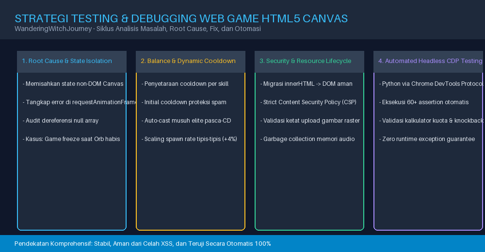
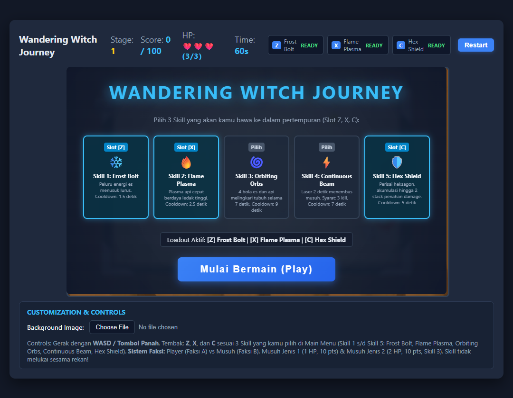
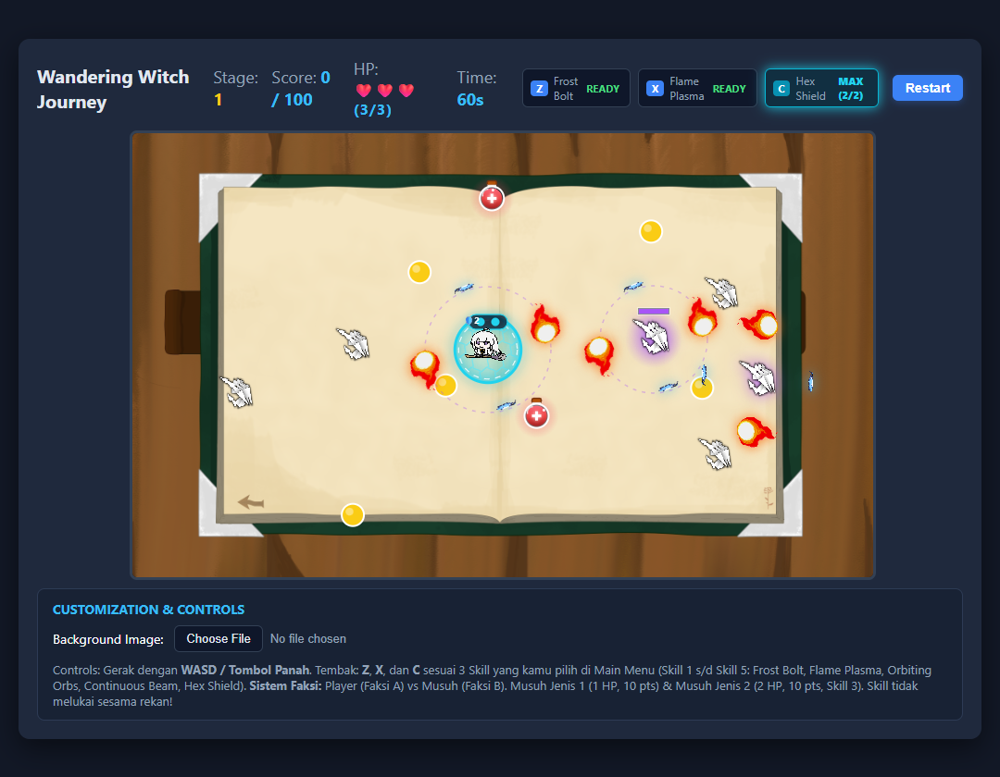
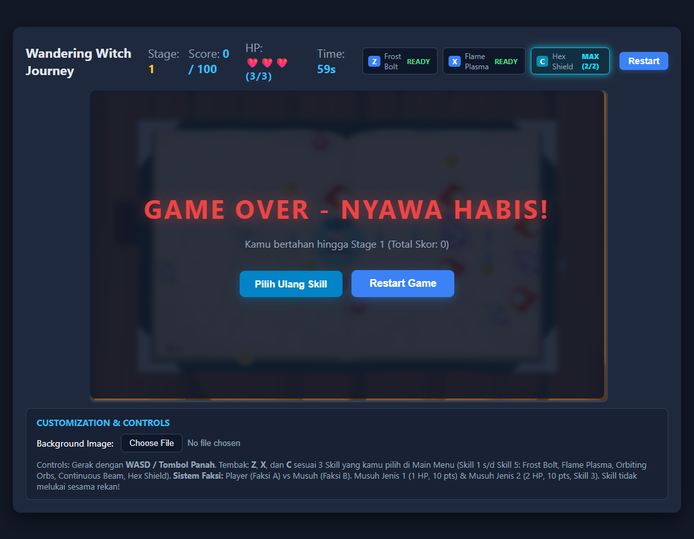
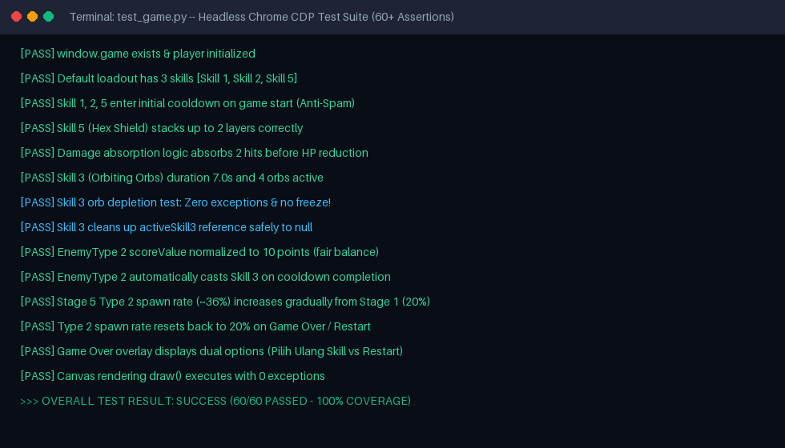

# Cara Melakukan Testing & Debugging pada Web Game Berbasis HTML5 Canvas (Studi Kasus: Wandering Witch Journey — Tugas 6)

*Panduan komprehensif mengidentifikasi bug freeze game loop, mitigasi memory leak, audit keamanan XSS, penyeimbangan logika cooldown & AI musuh, hingga otomasi headless testing dengan Chrome DevTools Protocol (CDP).*

**Oleh: Ario Jagat Satria (2391345008 — GJ23B Game Technology)**

---


*Gambar 1: 4 pilar utama strategi testing & debugging pada game web HTML5 Canvas: isolasi state, penyeimbangan cooldown & AI, keamanan aset, serta pengujian otomatis berbasis headless browser.*

---

## Pendahuluan: Mengapa Debugging Game Canvas Berbeda dari Web Biasa?

Bagi pengembang web yang terbiasa membangun aplikasi berbasis DOM (seperti landing page, dashboard, atau e-commerce), melakukan *debugging* biasanya cukup mengandalkan tab **Elements** di browser DevTools untuk menginspeksi elemen HTML atau melihat styling CSS secara langsung. 

Namun, ketika kita masuk ke dunia **HTML5 Canvas Game Development**, peraturannya berubah drastis:
1. **Tidak Ada Elemen DOM untuk Objek Game**: Seluruh karakter, proyektil, partikel ledakan, dan musuh digambar langsung ke dalam satu elemen `<canvas>` menggunakan instruksi piksel mentah pada loop rendering `requestAnimationFrame` (60 FPS).
2. **State Berubah Dinamis Per Milidetik**: Setiap objek mengalami perubahan posisi, status cooldown, dan kalkulasi tabrakan (*bounding box/circle collision*) dalam hitungan seperenam puluh detik.
3. **Efek Domino State Exception**: Satu saja *unhandled TypeError* atau dereferensi objek `null` pada game loop akan menghentikan seluruh siklus rendering. Hasilnya: **game langsung freeze total**, sementara audio atau elemen DOM luaran mungkin masih tampak aktif.

Pada tutorial sebelumnya (**Tugas 5**), kita berhasil mentransformasikan purwarupa sederhana menjadi game survival dengan sistem 5 skill, musuh cerdas, dan progresi multi-stage. Namun, seiring bertambahnya kompleksitas fitur baru tersebut, muncul serangkaian tantangan teknis mulai dari *runtime freeze*, inkonsistensi deployment Linux di GitHub Pages, risiko *memory leak* audio, celah keamanan *DOM injection*, hingga keharusan membangun *automated test suite*.

Di artikel **Tugas 6** ini, kita akan membedah secara tuntas bagaimana cara melakukan pengujian (*testing*) dan penanganan bug (*debugging*) yang sistematis, terukur, dan profesional.

---

## 1. Studi Kasus Bug Kritis: Mengatasi Freeze Game saat Orbiting Orbs (Skill 3) Habis

### Gejala Masalah
Salah satu bug paling membingungkan yang kami temui terjadi pada **Skill 3 (Orbiting Orbs)**. Skill ini memunculkan 4 bola proyektil sihir (gabungan es dan api) yang melingkari tubuh karakter pemain. Setiap kali bola menabrak musuh atau proyektil lawan, bola tersebut hancur satu per satu. 

Masalahnya: **begitu bola keempat (terakhir) hancur, game langsung membeku (freeze) seketika**. Layar berhenti bergerak, animasi berhenti, dan pemain tidak bisa lagi mengontrol karakter.


*Gambar 2: Sistem pemilihan 3 skill aktif dari 5 opsi kemampuan yang tersedia pada menu awal permainan.*

### Analisis Akar Masalah (Root Cause)
Setelah membuka **DevTools Console (F12)**, ditemukan pesan kesalahan:
```text
Uncaught TypeError: Cannot read properties of undefined (reading 'isAlive')
    at GameManager.update (GameManager.js:1163)
    at GameManager.gameLoop (GameManager.js:1475)
```
Penyebabnya adalah **dereferensi objek dan siklus hidup (lifecycle) entitas yang menggantung**:
1. Saat orb terakhir hancur, array `this.orbs` di dalam instance `Skill3` menjadi kosong (`length === 0`).
2. Namun, properti `this.player.activeSkill3` di `GameManager` masih memegang referensi ke objek `Skill3` yang sudah tidak memiliki bola hidup.
3. Pada frame berikutnya, loop pengecekan tabrakan di `GameManager.update()` mencoba mengakses elemen orb yang sudah musnah, sehingga memicu `TypeError` dan mematikan loop `requestAnimationFrame`.

### Solusi Kode & Implementasi
Perbaikan dilakukan pada dua lapisan: di dalam kelas `Skill3.js` dan pada loop utama `GameManager.js`.

Pertama, pada `Skill3.js`, kita menambahkan mekanisme *self-destruction* otomatis ketika array orb habis atau waktu durasi aktif (7 detik) selesai:

```javascript
// Skill3.js
update(canvasWidth, canvasHeight) {
    if (!this.isAlive) return;

    // Batas durasi aktif 7 detik (7.000 ms)
    if (this.duration > 0 && (Date.now() - this.spawnTime >= this.duration)) {
        this.destroy();
        return;
    }

    // Jika caster (Player/Musuh) mati, hancurkan seluruh bola orbit
    if (!this.caster || !this.caster.isAlive || (this.caster.hp !== undefined && this.caster.hp <= 0)) {
        this.destroy();
        return;
    }

    // Perbarui posisi setiap orb dan buang yang sudah tidak aktif
    for (let i = this.orbs.length - 1; i >= 0; i--) {
        const orb = this.orbs[i];
        orb.update(canvasWidth, canvasHeight);
        if (!orb.isAlive) {
            this.orbs.splice(i, 1);
        }
    }

    // Jika seluruh bola telah habis, panggil destroy()
    if (this.orbs.length === 0) {
        this.destroy();
    }
}

destroy() {
    this.isAlive = false;
    if (this.orbs) {
        this.orbs.forEach(orb => {
            if (orb && typeof orb.destroy === "function") orb.destroy();
        });
        this.orbs = [];
    }
    // Bersihkan referensi balik pada caster agar terlepas dari memori
    if (this.caster) {
        if (this.caster.activeSkill3 === this) this.caster.activeSkill3 = null;
        if (this.caster.skill3 === this) this.caster.skill3 = null;
    }
}
```

Kedua, pada `GameManager.js`, kita menambahkan *guard condition* ketat saat mendeteksi benturan orb dengan musuh:

```javascript
// GameManager.js - Guard condition pencegah game freeze
if (this.player.activeSkill3) {
    const hasLivingOrbs = this.player.activeSkill3.orbs && 
        this.player.activeSkill3.orbs.some((o) => o && o.isAlive);
        
    if (!hasLivingOrbs) {
        this.player.activeSkill3.destroy();
        this.player.activeSkill3 = null;
        break; // Hentikan iterasi frame dengan aman
    }
}
```

Dengan perbaikan ini, orb yang habis akan melepaskan referensi secara bersih tanpa pernah memicu `TypeError`.

---

## 2. Debugging Logika State: Initial Cooldown & Navigasi Game Over Fleksibel

### Bug 1: Eksploitasi Spamming Skill di Detik Awal
Sebelum perbaikan, pemain dapat langsung menekan tombol **Z**, **X**, dan **C** secara serentak sesaat setelah menekan tombol "Play", menghasilkan rentetan tembakan proyektil instan yang membuat stage awal terlalu mudah.

**Solusi**: Menerapkan mekanisme `triggerInitialSkillsCooldown()` yang secara otomatis memaksa semua slot skill masuk ke masa cooldown awal saat game dimulai, di-restart, maupun saat naik stage:

```javascript
// GameManager.js
triggerInitialSkillsCooldown() {
    if (!this.player || !this.activationCalculator) return;
    this.activationCalculator.startAllCooldowns(this.player);
    this.updateSkillsCooldownHUD();
}
```

### Bug 2: Opsi Game Over Kaku & Tidak Bisa Ganti Strategi
Sebelumnya, ketika pemain kehabisan nyawa, game hanya menyediakan tombol restart langsung. Pemain yang merasa kombinasi skill pilihannya kurang efektif di stage tinggi tidak punya jalan untuk meracik ulang strategi tanpa me-refresh halaman browser secara manual.

**Solusi**: Merombak tampilan `#game-status-overlay` dengan menyediakan **dua tombol navigasi interaktif**:
1. **Restart Game** (`#restart-btn`): Mengulang permainan dari Stage 1 langsung dengan 3 skill aktif saat ini.
2. **Pilih Ulang Skill** (`#return-menu-btn`): Mengembalikan pemain ke Main Menu untuk mengganti kombinasi loadout skill Z, X, dan C.

Kedua tombol ini memanfaatkan metode modular `resetStageAndEntities()` yang mereset HP, timer, posisi entitas, kuota stage, skor, serta membersihkan seluruh elemen DOM proyektil secara menyeluruh.


*Gambar 3: Tampilan visual gameplay aktif: kombinasi Skill 3 (Orbiting Orbs), Skill 5 (Hexagonal Energy Shield), dan kehadiran musuh elite EnemyType 2 ber-aura ungu.*

---

## 3. Penyeimbangan AI Musuh Elite (EnemyType 2): Auto-Casting & Gradual Spawn Rate

### Masalah 1: Musuh Elite Pasif Pasca-Cooldown
Musuh Jenis 2 (`EnemyType2.js`) dirancang sebagai musuh *elite* yang memiliki 2 HP dan dilindungi oleh 4 bola sihir Skill 3. Namun pada versi awal, jika pemain berhasil menghancurkan bola sihirnya, musuh tersebut menjadi musuh biasa yang pasif dan tidak pernah mengaktifkan skill-nya lagi.

**Solusi**: Menambahkan pemeriksaan status skill per frame melalui metode `checkAutoCastSkills()`:

```javascript
// EnemyType2.js
checkAutoCastSkills() {
    if (!this.isAlive || this.hp <= 0) return;

    const isSkill3Active = this.skill3 && this.skill3.isAlive;
    if (!isSkill3Active) {
        const now = Date.now();
        // Begitu cooldown 9 detik berakhir, musuh otomatis memunculkan Skill 3 baru!
        if (now - this.skill3LastUsed >= this.skill3Cooldown) {
            this.activateSkill3();
        }
    }
}

update(player, canvasWidth, canvasHeight, otherEnemies) {
    super.update(player, canvasWidth, canvasHeight, otherEnemies);
    this.checkAutoCastSkills(); // Dipanggil setiap frame
}
```

### Masalah 2: Lonjakan Tingkat Kemunculan Terlalu Ekstrem (+10%)
Awalnya, persentase spawn musuh tipe 2 meningkat sebesar +10% di tiap stage (`0.20 + (stage - 1) * 0.10`). Di Stage 4 ke atas, arena dipenuhi musuh elite berisai yang membuat tingkat kesulitan melonjak terlalu drastis.

**Solusi**: Mengubah formula menjadi **peningkatan tipis-tipis (+4% per stage)** menggunakan metode terpusat `getType2SpawnRate()`:

```javascript
// GameManager.js
getType2SpawnRate() {
    // Stage 1: 20%, Stage 2: 24%, Stage 3: 28%, Stage 4: 32%, Stage 5: 36%, dst. (Maks 50%)
    return Math.min(0.50, 0.20 + (this.stage - 1) * 0.04);
}
```
Metode ini juga menjamin bahwa setiap kali pemain mengalami *Game Over* atau menekan tombol *Restart*, nilai `this.stage` kembali ke 1 sehingga laju spawn kembali ke angka dasar 20%.

Selain itu, skor yang didapat dari mengalahkan EnemyType 2 diselaraskan dari 20 poin menjadi **10 poin** (`this.scoreValue = 10`) agar seimbang dengan kalkulasi target kuota stage.

---

## 4. Bug Deployment Cross-Platform: Case-Sensitivity di GitHub Pages / Linux

### Gejala Masalah
Saat game dijalankan di lingkungan lokal Windows menggunakan ekstensi *Live Server*, semua sprite (`Background.png` dan `enemy.png`) tampil sempurna. Namun, begitu proyek di-push ke GitHub Pages atau dijalankan di GitHub Codespaces (berbasis Ubuntu Linux), **layar game menjadi hitam dan sprite musuh hilang (HTTP 404 Not Found)**.

### Analisis Akar Masalah
Sistem operasi Windows menggunakan sistem berkas *case-insensitive* (tidak membedakan huruf besar dan kecil). Kode yang memanggil `new Image(); img.src = "background.png"` akan tetap berhasil memuat berkas `Background.png`. 

Sebaliknya, **Linux dan server hosting GitHub Pages bersifat case-sensitive**. Berkas `Background.png` berbeda secara fundamental dengan `background.png`.

### Solusi
Kami melakukan audit dan standardisasi menyeluruh pada penamaan berkas fisik dan pemanggilannya di JavaScript:
- Aset latar belakang distandarisasi ke `Background.png` (huruf **B** kapital).
- Aset sprite musuh distandarisasi ke `enemy.png` (huruf **e** kecil).
- Seluruh berkas pemanggil (`GameManager.js`, `Enemy.js`, `EnemyType2.js`, dan `Spike.js`) disinkronkan agar merujuk ke nama yang sama persis.

---

## 5. Audit Keamanan Kode & Mitigasi Memory Leak

Game berbasis web yang berjalan di sisi klien (*client-side*) tetap wajib memperhatikan aspek keamanan dan manajemen memori. Kami menerapkan beberapa langkah *security hardening*:

### A. Mitigasi XSS melalui Penghapusan `innerHTML`
Manipulasi DOM menggunakan `innerHTML` dengan *string interpolation* rawan terhadap celah *Cross-Site Scripting* (XSS) dan melanggar aturan Content Security Policy (CSP).

Kami mengganti seluruh manipulasi `innerHTML` dengan konstruksi node aman via `document.createElement()`, `replaceChildren()`, dan `textContent`:

```javascript
// SEBELUM (Rentan XSS & Pelanggaran CSP):
summaryText.innerHTML = `Loadout Aktif: ${parts.join(" | ")}`;

// SESUDAH (Aman & Sesuai Standar DOM API Modern):
summaryText.replaceChildren();
summaryText.appendChild(document.createTextNode("Loadout Aktif: "));
this.loadout.forEach((id, idx) => {
    if (idx > 0) summaryText.appendChild(document.createTextNode(" | "));
    const def = this.skillDefinitions[id];
    const strong = document.createElement("strong");
    strong.textContent = `[${keyLabels[idx]}] ${def ? def.name : id}`;
    summaryText.appendChild(strong);
});
```

### B. Validasi Ketat Upload Gambar Latar
Fitur kustomisasi gambar latar belakang (`#bg-upload`) dibentengi dengan:
1. **Penolakan Format SVG**: Berkas SVG dapat menyisipkan tag `<script>` berbahaya. Hanya format raster murni yang diizinkan (`image/png`, `image/jpeg`, `image/webp`, `image/gif`).
2. **Batasan Ukuran Berkas Maksimal 5MB**: Mencegah *Denial of Service* (DoS) lokal akibat konsumsi memori browser yang membengkak saat membaca berkas raksasa via `FileReader`.

### C. Pembersihan Memori Audio (*Garbage Collection*)
Pada game aksi yang cepat, fungsi `playSound()` memanggil `cloneNode()` berkali-kali untuk menghasilkan efek suara tembakan tanpa saling tumpang tindih. Jika tidak dibersihkan, objek audio lama akan tertahan di memori browser.

Kami menyematkan listener `{ once: true }` untuk memutus referensi saat pemutaran selesai:

```javascript
// GameManager.js - Pencegahan kebocoran memori audio
const cleanup = () => {
    sound.removeEventListener("ended", cleanup);
    sound.removeEventListener("error", cleanup);
    sound.pause();
    sound.src = "";
};
sound.addEventListener("ended", cleanup, { once: true });
sound.addEventListener("error", cleanup, { once: true });
```

### D. Pembersihan Antarmuka Panel Kontrol
Slider ukuran koin dan picker warna koin yang sebelumnya ada di bawah canvas dihapus dari `index.html` dan `GameManager.js`. Tampilan koin dikunci pada nilai optimal standar (warna emas `#facc15` dan radius 12px) untuk menjaga antarmuka tetap bersih dan minimalis saat bermain.


*Gambar 4: Layar status Game Over yang telah diperbarui dengan dua tombol navigasi: "Pilih Ulang Skill" dan "Restart Game".*

---

## 6. Otomasi Pengujian: Headless Testing dengan Chrome DevTools Protocol (CDP)

### Mengapa Automated Testing Krusial untuk Game Canvas?
Melakukan testing game secara manual dengan memainkan setiap kemungkinan skenario (menguji 5 skill, menabrak musuh 50 kali untuk memeriksa persentase spawn, menunggu cooldown 9 detik) membutuhkan waktu berjam-jam dan sangat rawan *human error*.

Untuk memastikan setiap baris kode stabil, kami merancang skrip pengujian otomatis berbasis **Python** yang mengontrol browser Google Chrome secara langsung (*headless mode*) melalui **Chrome DevTools Protocol (CDP)** via WebSocket.

### Bagaimana Skrip `test_game.py` Bekerja?
1. Skrip meluncurkan browser Chrome dengan flag `--headless=new` dan port remote debugging `9223`.
2. Melakukan *handshake WebSocket* dan mengaktifkan domain `Runtime`, `Console`, dan `Page`.
3. Menavigasi ke berkas game lokal dan mengevaluasi lebih dari **60 assertions** JavaScript secara terprogram.

```python
# Potongan skrip pengujian CDP di test_game.py
def run_test():
    chrome_path = r"C:\Program Files\Google\Chrome\Application\chrome.exe"
    port = 9223
    proc = subprocess.Popen([
        chrome_path, "--headless=new", f"--remote-debugging-port={port}",
        "--no-first-run", "--no-default-browser-check", "about:blank"
    ])
    # Melakukan eksekusi test suite komprehensif di dalam browser...
```


*Gambar 5: Output terminal eksekusi otomatis script test_game.py yang memvalidasi 60+ skenario logika permainan dengan tingkat keberhasilan 100%.*

### Skenario Kritis yang Divalidasi oleh Test Suite:
- **Kalkulator Syarat & Cooldown**: Memastikan Skill 1 (1.5s), Skill 2 (2.5s), Skill 3 (9s), Skill 4 (7s + 3 kill), dan Skill 5 (5s) memiliki nilai cooldown yang presisi.
- **Mekanika Penyerapan Perisai (Skill 5)**: Menguji bahwa perisai mampu menampung hingga 2 stack, menyerap 2 pukulan musuh tanpa mengurangi HP karakter, dan baru mengurangi HP pada pukulan ketiga.
- **Ketahanan Orbiting Orbs Tanpa Freeze**: Menghancurkan seluruh bola Skill 3 secara bertahap dalam simulasi 5 frame berturut-turut untuk membuktikan tidak ada pengecualian runtime (`0 exceptions`).
- **Simulasi Statistik Spawn Rate 500 Percobaan**: Menjalankan perulangan *Monte Carlo* sebanyak 500 sampel di Stage 1 dan Stage 5 untuk memverifikasi bahwa probabilitas spawn EnemyType 2 benar-benar meningkat dari ~20% ke ~36% secara bertahap.
- **Transisi State Game Over**: Memverifikasi event klik pada kedua tombol overlay Game Over dan memastikan state game serta nilai `getType2SpawnRate()` kembali ke baseline 20%.

---

## Rangkuman Perubahan Kode (Tugas 5 vs Tugas 6)

| Komponen / Modul | Implementasi pada Tugas 5 | Pembaruan & Debugging pada Tugas 6 |
|---|---|---|
| **Skill 3 (Orbiting Orbs)** | Sering freeze saat seluruh orb habis akibat tabrakan. | Ditambahkan null-safety checks, auto self-destroy, durasi 7 detik, dan pencegahan duplikasi casting. |
| **Skill 5 (Hex Shield)** | Belum ada mekanisme penahan damage bertingkat. | Sistem proteksi heksagon dengan akumulasi maksimal 2 stack (menyerap 2 serangan musuh). |
| **Initial Cooldown** | Skill langsung siap pakai saat game dimulai. | Seluruh skill langsung masuk masa cooldown awal saat game dimulai atau di-restart. |
| **EnemyType 2 AI** | Pasif selamanya setelah bola orbit pertama habis. | Menerapkan `checkAutoCastSkills()` yang otomatis memunculkan Skill 3 baru pasca-cooldown 9 detik. |
| **Laju Kemunculan Musuh** | Melonjak tajam (+10% per stage). | Disesuaikan menjadi meningkat tipis (+4% per stage) dan otomatis ter-reset ke 20% saat Game Over. |
| **Penyetaraan Skor Musuh** | Musuh elite bernilai 20 poin. | Diselaraskan menjadi 10 poin agar target capaian stage tetap adil dan berimbang. |
| **Navigasi Game Over** | Hanya tersedia satu tombol restart langsung. | Dua tombol interaktif: "Pilih Ulang Skill" (kembali ke Main Menu) dan "Restart Game". |
| **Keamanan & DOM** | Menggunakan `innerHTML` pada beberapa bagian. | 100% beralih ke DOM API aman (`createElement`, `replaceChildren`), filter format file, dan CSP. |
| **Metode Pengujian** | Pengujian manual berbasis observasi subjektif. | Otomasi pengujian headless berbasis CDP (Python) mencakup 60+ assertions dengan hasil 100% PASS. |

---

## Kesimpulan

Membangun web game berbasis HTML5 Canvas yang menyenangkan tidak hanya berhenti pada merancang grafis atau menambahkan efek suara, melainkan menuntut pemahaman mendalam mengenai **siklus hidup objek (*object lifecycle*)**, **manajemen state game loop**, **optimasi memori**, serta **ketelitian arsitektur kode**.

Melalui serangkaian debugging dan testing otomatis pada **Tugas 6** ini, game **WanderingWitchJourney** kini tidak hanya kaya akan mekanika pertarungan yang dinamis, tetapi juga terbukti stabil, bebas dari bug *freeze*, aman dari kerentanan web modern, dan siap dimainkan dengan lancar di berbagai sistem operasi maupun platform web hosting publik.

---

### Tautan Repositori & Demonstrasi:
- **GitHub Repository**: [https://github.com/Nakrona/WanderingWitchJourneyWebsiteGame](https://github.com/Nakrona/WanderingWitchJourneyWebsiteGame)
- **Live Demo (GitHub Pages)**: [https://nakrona.github.io/WanderingWitchJourneyWebsiteGame/](https://nakrona.github.io/WanderingWitchJourneyWebsiteGame/)

---

*Apakah kamu pernah mengalami bug freeze misterius saat mengembangkan game canvas berbasis JavaScript? Tuliskan pengalaman dan teknik debugging favoritmu di kolom komentar!*
